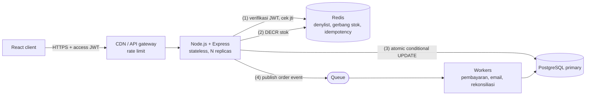
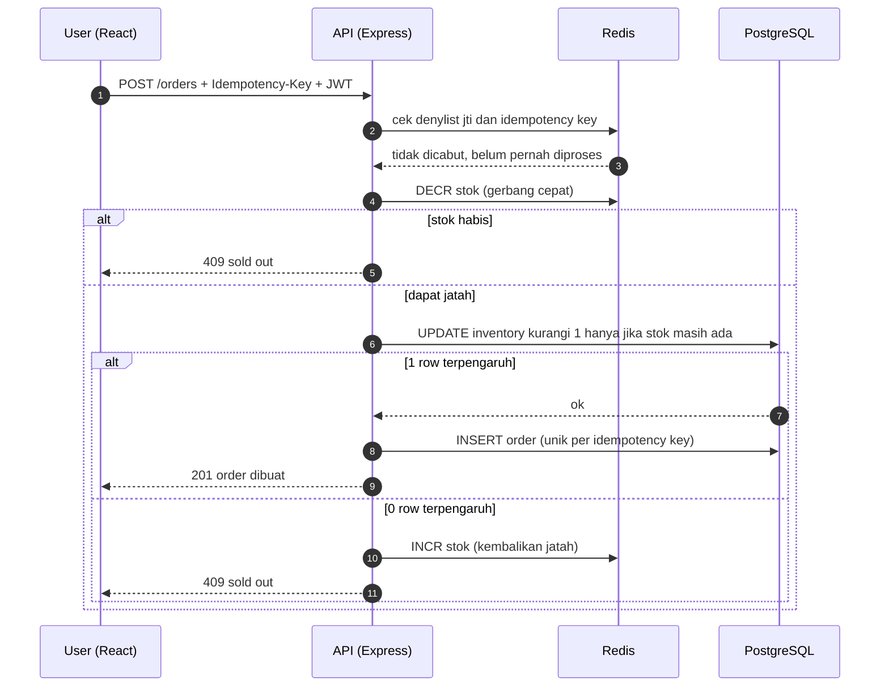

# Work Sample Test — Fullstack Development & Business Systems

**Kandidat:** Damar Pradnyana · **Posisi:** Senior Fullstack JavaScript / React Engineer

Semua jawaban ada di file ini. Kode fungsional untuk Soal #1 ada di folder [`src/`](./src).

## Daftar isi

- [Cara menjalankan](#cara-menjalankan)
- [Catatan prioritisasi waktu](#catatan-prioritisasi-waktu)
- [Soal #1 — Optimasi performa & state management React](#soal-1--optimasi-performa--state-management-react)
- [Soal #2 — Arsitektur backend, JWT, & high-concurrency](#soal-2--arsitektur-backend-jwt--high-concurrency)
- [Soal #3 — Webhook reliability & resiliency](#soal-3--webhook-reliability--resiliency)
- [Soal #4 — TCO: monolith vs microservices](#soal-4--tco-monolith-vs-microservices)
- [Soal #5 — Prioritisasi fitur, LTV/CAC, & tech debt](#soal-5--prioritisasi-fitur-ltvcac--tech-debt)

## Cara menjalankan

Membutuhkan Node.js 20.19+ (dibutuhkan Vite 8).

```bash
npm install
npm start          # dev server Vite, buka URL yang dicetak di terminal
npm run build      # typecheck (tsc) + production build
npm run preview    # serve hasil build produksi
```

Di aplikasi: centang **Tampilkan render counter**, lalu klik **+** / **−** pada satu baris. Hanya
counter baris itu yang bertambah (`×1 → ×2`); baris lain tetap.

## Catatan prioritisasi waktu

Bobot rubrik: Soal #1 dan #2 masing-masing 25%, #3 20%, #4 dan #5 masing-masing 15%. Saya tidak
membagi waktu 1:1 dengan bobot: Soal #2 adalah essay murni tetapi bobotnya sama dengan kode Soal #1,
jadi ia mendapat porsi waktu setara. Soal #3–#5 dijawab lebih ringkas, tetapi tetap memakai struktur
yang sama (konteks → opsi → keputusan → alasan) agar jawabannya bisa dinilai, bukan sekadar daftar poin.

Dua keputusan scope yang disengaja:

- **Soal #1:** satu pendekatan yang bersih (virtualization + memoization + state yang stabil),
  bukan semua teknik sekaligus. Lebih mudah dijelaskan dan dibuktikan.
- **Soal #2–#5:** tidak ada implementasi backend. Soal tidak mensyaratkan kode, jadi jawaban berupa
  analisis, kode ilustratif, dan diagram.

---

## Soal #1 — Optimasi performa & state management React

### Diagnosis: kenapa satu perubahan kecil me-render ulang seluruh dashboard?

Kondisi awal yang umum: array 5.000 produk disimpan di `useState` pada komponen dashboard, dan satu
item diubah lewat `setProducts(prev => prev.map(...))`.

1. **Render menjalar ke bawah secara default.** Saat state di root berubah, React memanggil ulang
   fungsi komponen root dan, tanpa `React.memo`, seluruh turunannya: 5.000 × `ProductRow`, beserta
   reconciliation-nya. Yang mahal bukan update DOM-nya (React hanya menyentuh yang berubah),
   melainkan memanggil dan membandingkan 5.000 komponen di main thread dalam satu frame.
2. **Identitas prop tidak stabil, sehingga `React.memo` percuma.** Callback inline
   (`onUpdate={() => ...}`), objek literal baru, atau `map` yang membuat objek baru untuk *semua*
   item membuat shallow-compare selalu gagal. Memoization hanya bekerja kalau item yang tidak
   berubah mempertahankan referensinya.
3. **Biaya DOM.** 5.000 baris × ±6 node ≈ 30.000 node. Layout, paint, dan memori mahal walaupun
   React-nya efisien; ini tidak bisa diselesaikan dengan memoization saja.
4. **Context / derived value yang berubah identitas.** `value={{ ... }}` pada Provider atau hasil
   turunan yang dihitung ulang tiap render memaksa semua consumer ikut render.

Cara membuktikannya: React DevTools Profiler (*Record why each component rendered*) menunjukkan
5.000 baris dengan alasan "parent rendered", dan panel Performance menunjukkan long task di fase
render + layout.

### Solusi

Tiga lapis, masing-masing menyerang satu penyebab di atas:

| Penyebab | Solusi | File |
|---|---|---|
| Terlalu banyak komponen / node | Virtualization dengan `react-window` (`FixedSizeList`): hanya ±20 baris yang ter-mount | [`ProductTable.tsx`](./src/components/ProductTable.tsx) |
| Semua baris render ulang | `React.memo` pada baris + referensi item yang tidak berubah tetap sama | [`ProductRow.tsx`](./src/components/ProductRow.tsx), [`useProducts.ts`](./src/useProducts.ts) |
| Callback / prop tidak stabil | `dispatch` dari `useReducer` + `useCallback([])` sehingga `onAdjustStock` stabil | [`useProducts.ts`](./src/useProducts.ts) |

**Reducer yang menjaga referensi** ([`useProducts.ts`](./src/useProducts.ts)):

```ts
function reducer(products: Product[], action: Action): Product[] {
  const index = products.findIndex((p) => p.id === action.id);
  if (index === -1) return products;

  const current = products[index];
  const stock = Math.max(0, current.stock + action.delta);
  if (stock === current.stock) return products; // no-op: tidak memicu render sama sekali

  const next = products.slice();
  next[index] = { ...current, stock }; // hanya item ini yang dapat referensi baru
  return next;
}
```

**Baris yang di-memo** ([`ProductRow.tsx`](./src/components/ProductRow.tsx)):

```tsx
export const ProductRow = memo(function ProductRow({ product, rowIndex, style, onAdjustStock }: ProductRowProps) {
  // ...
});
```

`style` aman untuk shallow-compare karena `react-window` meng-cache objek style per index.

**Virtualized list** ([`ProductTable.tsx`](./src/components/ProductTable.tsx)):

```tsx
// level modul: identitas stabil, jadi FixedSizeList (PureComponent) bisa melewati render
const getItemKey = (index: number, data: RowData) => data.products[index].id;

<FixedSizeList
  height={560} width="100%" itemSize={56} overscanCount={10}
  itemCount={products.length}
  itemData={itemData}        // di-memo dengan useMemo
  itemKey={getItemKey}       // key stabil: id, bukan index
  outerElementType={Scroller} // focusable, bisa di-scroll dengan keyboard
  innerElementType={RowGroup} // role="rowgroup"
>
  {Row}
</FixedSizeList>
```

### Strategi state management agar update satu item tidak memicu render global

1. **Update immutable dengan structural sharing.** Hanya item yang berubah mendapat objek baru;
   sisanya mempertahankan referensi, jadi `React.memo` bisa memutuskan "skip" dengan murah.
2. **Callback yang stabil.** Aksi dikirim lewat `dispatch` (stabil seumur komponen), bukan closure
   yang dibuat ulang tiap render. Tidak ada `setProducts(prev => ...)` yang dilempar ke bawah.
3. **Data turunan di-`useMemo`, bukan disimpan sebagai state kedua.** `StockSummary` menghitung
   ringkasan dari `products` dan di-memo, sehingga mengetik di kolom pencarian (yang tidak mengubah
   `products`) tidak menghitung ulang ringkasan.
4. **Input yang cepat dipisah dari kerja yang mahal.** Query pencarian memakai `useDeferredValue`,
   jadi mengetik tetap responsif walau filter 5.000 item berjalan.
5. **Jangan jadikan semuanya satu state global.** State UI lokal (query, toggle) tidak perlu
   menyentuh data produk.

**Kapan naik level?** Pada contoh ini state tinggal di satu komponen, dan induknya tetap render
ringan karena virtualization (hanya ±20 baris yang dievaluasi). Jika banyak konsumen berbeda
mengakses item yang sama atau data masuk real-time lewat WebSocket, saya akan memindahkan ke store
dengan **selector per item** (Zustand, atau Redux Toolkit `createEntityAdapter` + `useSelector`,
atau `useSyncExternalStore`), sehingga tiap baris berlangganan `byId[id]` dan induk tidak render
sama sekali. Untuk update beruntun, buffer pesan dan flush per frame (`requestAnimationFrame` /
`startTransition`). Trade-off-nya: tambahan dependency dan indireksi yang belum sebanding di skala
komponen ini.

### Bukti

Diukur di build produksi (`vite preview`) dengan skrip di browser:

| Pengukuran | Hasil |
|---|---|
| Baris logis (`aria-rowcount`, termasuk header) | 5.001 |
| Baris ter-mount di DOM | 20 |
| Klik **+** pada satu baris: `ProductRow` yang dieksekusi ulang | 1 dari 20 (counter `×1 → ×2`, stok 93 → 94) |
| Pencarian `sku-00042` | 1 baris hasil (`aria-rowcount` = 2) |

Transparansi soal apa yang tetap berjalan per klik: `App`, `StockSummary` (totalnya memang
berubah), `ProductTable`, `FixedSizeList`, dan ±20 wrapper `Row` yang tipis ikut dievaluasi. Yang
dilindungi `React.memo` adalah `ProductRow`, yaitu bagian yang mahal; biaya sisanya konstan terhadap
jumlah baris yang terlihat, bukan terhadap 5.000 item.

### Trade-off & batasan yang saya sadari

- **Virtualization vs. aksesibilitas dasar.** Baris di luar layar tidak ada di DOM, jadi tidak bisa
  di-Tab atau ditemukan dengan Ctrl+F sampai ter-scroll masuk. Mitigasi: kolom pencarian, role
  ARIA `table` / `row` / `cell` / `columnheader` dengan `aria-rowindex` + `aria-rowcount` agar
  screen reader tahu total baris, dan scroller yang focusable.
- **Tinggi baris tetap.** Dipilih agar scroll terasa native dan perhitungan murah; baris dengan tinggi
  dinamis butuh `VariableSizeList` + pengukuran dan di luar kebutuhan soal ini.
- **`react-window` dipin ke v1** agar API-nya sama dengan snippet `FixedSizeList` di soal.
- **Render counter** hanya alat bantu evaluator; ia menulis ke DOM dari effect dan disembunyikan
  lewat CSS, jadi menampilkannya tidak menyebabkan render.

---

## Soal #2 — Arsitektur backend, JWT, & high-concurrency

### Pilihan tech stack: Node.js + Express (TypeScript)

- **Konteks:** flash sale = ribuan request/detik, tetapi pekerjaannya I/O-bound (verifikasi token,
  Redis, DB). Bottleneck sebenarnya adalah *contention* pada baris stok dan connection pool DB, bukan
  kecepatan bahasa.
- **Opsi:** Go (throughput mentah dan concurrency murah), Java/Spring (ekosistem matang), Python/PHP
  (cepat dikembangkan, tetapi model concurrency lebih sulit untuk workload ini), Node.js.
- **Keputusan:** Node.js + Express.
- **Alasan:** satu bahasa dan tipe bersama dengan frontend React (kontrak API/DTO dibagi, satu tim
  bisa mengerjakan keduanya), event loop cocok untuk I/O-bound, dan ekosistem `jsonwebtoken` / `jose`,
  `ioredis`, `pg`, dan BullMQ matang. Express cukup; Fastify bisa dipertimbangkan bila profiling
  menunjukkan overhead framework yang material. Jika ada bagian CPU-bound, ia dipisah ke worker.

### 1. Token revocation tanpa merusak sifat stateless JWT

**Masalahnya:** JWT yang sudah diterbitkan valid sampai `exp`, jadi logout atau akun yang
dikompromikan tidak otomatis mencabut token. Jujur soal trade-off: *revocation instan* dan
*stateless murni* tidak bisa didapat bersamaan. Yang bisa dilakukan adalah membuat state-nya sekecil
dan sesementara mungkin.

| Opsi | Kelebihan | Kekurangan |
|---|---|---|
| Hanya access token pendek | Murni stateless | Logout tidak instan; jendela serangan = umur token |
| Denylist `jti` di Redis (TTL = sisa umur token) | Revocation instan, state kecil dan otomatis kedaluwarsa | Satu lookup Redis per request |
| `token_version` per user di claim | Satu operasi mencabut semua token user ("logout semua perangkat") | Butuh lookup versi (cache) |
| Session server-side | Kontrol penuh | Bukan JWT lagi; stateful sepenuhnya |

**Keputusan (hybrid):**

- **Access token** berumur pendek (5–15 menit), ditandatangani asimetris (RS256 / EdDSA, ada `kid`
  agar key bisa dirotasi). Verifikasi signature + `exp` / `iss` / `aud` dilakukan lokal tanpa hit
  jaringan; algoritma `none` ditolak.
- **Refresh token** opaque, disimpan sebagai hash, **dirotasi** setiap dipakai dengan *reuse
  detection*: jika refresh token lama dipakai lagi, seluruh *token family* dicabut.
- **Logout** = hapus refresh token + masukkan `jti` access token ke Redis dengan TTL = sisa umur
  token. Denylist hanya berisi token yang dicabut dalam 10–15 menit terakhir, jadi kecil.
- **"Logout semua perangkat" / ganti password** = naikkan `token_version` user.
- **Tiered check:** endpoint biasa cukup verifikasi signature; endpoint sensitif (pembayaran, ubah
  password) juga cek denylist + `token_version`.

**Alasan:** 99% request tetap murni stateless dan bisa diskalakan horizontal; biaya state hanya
muncul saat dibutuhkan, dan batas risiko terburuknya adalah umur access token yang pendek.

### 2. Race condition: 100 user membeli 1 sisa barang

**Masalahnya:** pola *read-modify-write* (`SELECT stock` → cek `> 0` → `UPDATE stock = stock - 1`)
tidak atomik. 100 transaksi bisa membaca `stock = 1` bersamaan, dan semuanya lolos (*oversell*).

| Opsi | Cara | Catatan |
|---|---|---|
| **Atomic conditional update** | `UPDATE ... SET stock = stock - 1 WHERE sku_id = $1 AND stock > 0`, cek `rowCount` | Satu statement, atomik; tidak butuh transaksi panjang |
| Pessimistic lock | `SELECT ... FOR UPDATE` dalam transaksi | Benar, tetapi antrean lock menahan connection; pool bisa habis saat spike |
| Optimistic lock | Kolom `version`, retry saat konflik | Pada hot row, hampir semua request konflik dan retry-storm |
| Redis `DECR` / Lua | Reservasi di memori sebelum menyentuh DB | Sangat cepat, tetapi Redis bukan sumber kebenaran yang durable |
| NoSQL | MongoDB `findOneAndUpdate({stock: {$gt: 0}}, {$inc: {stock: -1}})`, DynamoDB `ConditionExpression` | Atomik per dokumen / item |

**Keputusan:** PostgreSQL dengan **atomic conditional update** sebagai sumber kebenaran, dengan
**counter Redis sebagai gerbang depan**, plus **idempotency key** pada `POST /orders`.

```sql
UPDATE inventory
SET    stock = stock - 1
WHERE  sku_id = $1 AND stock > 0;
-- rowCount = 1 → berhasil; rowCount = 0 → habis

ALTER TABLE inventory ADD CONSTRAINT stock_non_negative CHECK (stock >= 0); -- jaring pengaman
```

```ts
const { rowCount } = await client.query(
  'UPDATE inventory SET stock = stock - 1 WHERE sku_id = $1 AND stock > 0',
  [skuId],
);
if (rowCount === 0) throw new SoldOutError();
```

**Alasan:**

- Pada isolation level default (`READ COMMITTED`), update konkuren pada baris yang sama menunggu
  yang pertama commit lalu mengevaluasi ulang `WHERE`. Dari 100 request, tepat 1 yang berhasil, 99
  mendapat `rowCount = 0`. Kebenaran dijamin database, bahkan jika Redis hilang.
- Gerbang Redis (`DECR`, undo bila negatif) memotong ribuan request yang pasti gagal sebelum sampai
  ke DB. Counter-nya direkonsiliasi dari DB secara berkala.
- Idempotency key (unik per order) membuat retry klien / jaringan tidak membuat order ganda.
- Jika satu SKU menjadi hot row ekstrem (puluhan ribu request/detik), stok dipecah menjadi beberapa
  *bucket* baris yang dikurangi secara acak.

### 3. Diagram arsitektur



Alur pembelian saat flash sale:



---

## Soal #3 — Webhook reliability & resiliency

### 1. Idempotency pada endpoint webhook

- **Konteks:** payment gateway mengirim webhook dengan semantik *at-least-once*. Duplikat dan
  urutan terbalik pasti terjadi, jadi handler harus aman dijalankan berulang.
- **Opsi:** (a) cek-lalu-proses di aplikasi (rentan race), (b) dedup dengan unique constraint di
  database, (c) hanya mengandalkan state machine order.
- **Keputusan:** kombinasi (b) + (c), dua lapis.

1. **Verifikasi dulu:** signature HMAC atas *raw body* (compare constant-time), toleransi timestamp
   untuk menolak replay lama, dan cocokkan `amount` / `currency` dengan order.
2. **Dedup event:** tabel `payment_events` dengan `UNIQUE (event_id)`.

   ```sql
   INSERT INTO payment_events (event_id, order_id, type, payload)
   VALUES ($1, $2, $3, $4)
   ON CONFLICT (event_id) DO NOTHING;
   -- rowCount = 0 → duplikat: balas 200 dan berhenti
   ```

3. **Guard state machine:** transisi hanya sah dari status yang diharapkan, sehingga event
   terlambat atau terbalik urutannya tidak merusak data.

   ```sql
   UPDATE orders SET status = 'PAID', paid_at = now()
   WHERE id = $1 AND status = 'PENDING';
   ```

4. **Ack cepat:** setelah event tersimpan durable, balas `2xx` lalu proses efek samping (kirim
   email, aktivasi) lewat queue, agar gateway tidak menganggap timeout.

Semantik respons: `200` untuk sukses *dan* duplikat; `4xx` hanya untuk signature tidak valid
(jangan di-retry); `5xx` untuk kegagalan sementara agar gateway mencoba lagi.

**Alasan:** unique constraint adalah satu-satunya dedup yang aman terhadap race antar instance;
state machine menambah ketahanan terhadap event yang tiba dengan `event_id` berbeda tetapi
transaksi yang sama. Untuk panggilan keluar ke gateway (buat charge), kita juga kirim
`Idempotency-Key` agar retry kita tidak menagih dua kali.

### 2. Fallback / retry untuk pembayaran yang menggantung

Tiga lapis, jangan hanya mengandalkan retry milik gateway:

| Lapis | Mekanisme | Tujuan |
|---|---|---|
| 1 | Retry bawaan gateway (exponential backoff) | Menangani glitch sesaat; tidak bisa dikontrol, jadi jangan dijadikan satu-satunya |
| 2 | **Reconciliation job**: order `PENDING` yang lebih tua dari N menit (5, 15, 60 dengan backoff) → panggil API status gateway → jalankan *fungsi transisi yang sama* dengan webhook | Menutup webhook yang benar-benar hilang |
| 3 | **Dead Letter Queue** untuk event yang gagal diproses setelah k percobaan (backoff + jitter), dengan alert dan tool replay | Poison message tidak memblokir antrean dan tidak hilang diam-diam |

Detail penting:

- Job rekonsiliasi memakai `SELECT ... FOR UPDATE SKIP LOCKED` agar aman dijalankan di banyak
  instance tanpa memproses order yang sama dua kali.
- Rate limit pemanggilan API gateway agar rekonsiliasi tidak membuat masalah baru.
- Order yang tidak kunjung dibayar kedaluwarsa (`EXPIRED`) dan stoknya dikembalikan.
- Rekonsiliasi harian membandingkan ledger kita dengan file settlement gateway sebagai jaring
  pengaman terakhir.

### 3. Mengomunikasikan status ke frontend tanpa membebani server

| Opsi | Cocok untuk | Catatan |
|---|---|---|
| Polling | Paling sederhana, stateless | Beban naik linear dengan jumlah user; perlu backoff |
| WebSocket | Komunikasi dua arah (chat, kolaborasi) | Overkill untuk status satu arah; sticky connection, konfigurasi LB lebih rumit |
| **Server-Sent Events** | Push satu arah server → klien | Di atas HTTP biasa, reconnect otomatis (`Last-Event-ID`), mudah dengan cookie auth |

**Keputusan:** SSE per halaman pembayaran aktif (`GET /orders/:id/events`), di-publish dari backend
lewat Redis pub/sub saat status order berubah. Fallback ke polling dengan backoff (2 s → 5 s → 10 s,
maksimum 30 s) bila `EventSource` gagal, dan berhenti begitu status terminal.

```tsx
type PaymentStatus = 'PENDING' | 'PAID' | 'FAILED' | 'EXPIRED';

function usePaymentStatus(orderId: string) {
  const [status, setStatus] = useState<PaymentStatus>('PENDING');

  useEffect(() => {
    const source = new EventSource(`/api/orders/${orderId}/events`, { withCredentials: true });
    source.addEventListener('status', (event) => {
      const next = JSON.parse((event as MessageEvent<string>).data).status as PaymentStatus;
      setStatus(next);
      if (next !== 'PENDING') source.close(); // status terminal: koneksi tidak dibutuhkan lagi
    });
    return () => source.close();
  }, [orderId]);

  return status;
}
```

**UX yang smooth:** tampilkan "Memverifikasi pembayaran…" setelah user kembali dari gateway (jangan
langsung bilang gagal); nonaktifkan tombol bayar agar tidak membayar dua kali; jika masih `PENDING`
setelah ±60 detik, jelaskan "kami masih memverifikasi, Anda akan menerima email" dan lepaskan
koneksi alih-alih menahan user di layar loading. Polling dijeda saat tab tidak terlihat
(`document.visibilityState`).

---

## Soal #4 — TCO: monolith vs microservices

### 1. Apakah migrasi menguntungkan secara bisnis?

- **Konteks:** monolith berjalan di ±$150/bulan; usulan: Kubernetes, Lambda, managed databases.
- **Keputusan:** **tidak**, untuk startup skala awal–menengah, kecuali ada pemicu spesifik (lihat
  bagian rekomendasi). TCO bukan hanya tagihan cloud:

  `TCO = infrastruktur + waktu engineer (operasi) + biaya migrasi (sekali) + biaya peluang (fitur tertunda) + risiko insiden`

**Estimasi kasar infrastruktur per bulan** (asumsi berdasarkan harga list AWS; angka riil berbeda
per region dan beban, verifikasi dengan AWS Pricing Calculator):

| Komponen | Monolith (sekarang) | Microservices / K8s |
|---|---|---|
| Compute | 1–2 VM | Control plane EKS ±$73 + 3 worker node ±$100–250 |
| Database | Termasuk di atas / satu instance | Managed DB Multi-AZ ±$100–200 |
| Jaringan | — | NAT gateway ±$32–70 + load balancer ±$20–40 |
| Observability | Log di server | Logging + tracing + metrik terpusat ±$50–300 |
| Lain-lain (registry, secrets, dll.) | — | ±$20–50 |
| **Total** | **±$150** | **±$400–1.000 (≈ 3–7×)** |

Setahun: ±$1,8 ribu vs ±$4,7–11,8 ribu, **sebelum** menghitung manusia. Biaya terbesarnya bukan itu:

- **Biaya migrasi:** misalnya 3 engineer × 3–6 bulan (9–18 engineer-bulan) dengan kecepatan fitur
  mendekati nol selama itu.
- **Waktu operasi berkelanjutan:** jika tiap engineer menghabiskan 20–30% waktunya untuk cluster,
  pipeline, IAM, dan debugging jaringan, tim 5 orang kehilangan 1–1,5 FTE dari fitur, yang nilainya
  jauh melampaui selisih tagihan cloud.

### 2. Hidden costs microservices

**Infrastruktur**

- Data transfer antar-AZ dan NAT per GB, yang tidak ada saat semuanya satu proses.
- Kapasitas menganggur: tiap service butuh replika minimum (N+1) dan limit resource sendiri.
- Database per service (atau database bersama yang menjadi anti-pattern), ditambah backup dan
  replika masing-masing.
- Lingkungan staging yang realistis berarti membayar beberapa kali; CI/CD per service.
- Volume log, trace, dan metrik naik drastis; harga observability tumbuh dengan jumlah service.

**Operasional / tim engineering**

- Konsistensi data: transaksi terdistribusi (saga, outbox), idempotency, dan bug eventual
  consistency yang sulit direproduksi.
- Kontrak antar-service: versioning API, contract test, backward compatibility.
- Debugging lintas service: butuh distributed tracing dan correlation ID sebelum bisa menjawab
  "kenapa request ini lambat?".
- Beban on-call dan kompleksitas incident (cascading failure, retry storm, timeout bertingkat).
- Permukaan keamanan: mTLS, secret, IAM per service.
- Onboarding dan development lokal yang lebih berat; beban kognitif lebih tinggi untuk tim kecil.

### 3. Rekomendasi: modular monolith (hybrid)

- **Satu deployable, batas modul yang tegas:** `catalog`, `orders`, `payments`, `inventory`,
  `identity`. Modul hanya saling memanggil lewat interface publik; ditegakkan dengan aturan lint /
  dependency boundary (misalnya `eslint-plugin-boundaries` atau Nx module boundaries).
- **Skema database terpisah per modul** (satu instance, banyak schema), tanpa join lintas modul:
  persiapan murah bila nanti diekstrak.
- **Event internal in-process** untuk decoupling antar-modul; antrean (BullMQ/SQS) untuk pekerjaan
  latar belakang, dijalankan sebagai proses worker dari codebase yang sama.
- **Skala dulu secara sederhana:** 2+ replika stateless di belakang load balancer, managed
  Postgres + Redis, CDN dan cache, read replica bila perlu. Perkiraan ±$250–400/bulan dengan
  overhead operasional yang hampir sama dengan sekarang.

**Kapan satu modul layak diekstrak** (pola *strangler*, satu per satu): kebutuhan scaling yang jelas
berbeda (mis. webhook pembayaran atau pemrosesan gambar), tim sudah saling menghambat saat deploy
(≈ 8–10+ engineer), kebutuhan isolasi compliance (PCI), atau siklus rilis yang benar-benar berbeda.

**Alasan:** biaya terendah dan kecepatan deliver tertinggi *sekarang*, tanpa menutup jalan. Batas
modul yang disiplin membuat ekstraksi nanti menjadi proyek kecil, bukan penulisan ulang.

---

## Soal #5 — Prioritisasi fitur, LTV/CAC, & tech debt

### 1. Mengomunikasikan dampak tech debt ke Product Manager & stakeholder non-teknis

- **Konteks:** PM ingin 3 fitur sprint ini demi target CAC; engineering menemukan debt yang berisiko
  membuat server down. Mengatakan "kodenya jelek" tidak akan menggerakkan siapa pun.
- **Keputusan:** terjemahkan debt menjadi **risiko bisnis** dalam bahasa yang sama dengan target PM,
  dan sajikan **opsi**, bukan ultimatum.

1. **Risiko = kemungkinan × dampak.** "Modul checkout tanpa timeout dan connection pooling akan
   tumbang saat traffic di atas X. Dengan beban kampanye, kemungkinannya tinggi; satu jam downtime ≈
   Rp N revenue + kampanye yang biayanya sudah keluar terbuang."
2. **Bunga utang yang sudah dibayar:** bukti dari data, bukan opini: jumlah insiden, MTTR, persentase
   waktu sprint untuk bug / rework, lead time per fitur yang makin panjang.
3. **Selaraskan dengan tujuan PM:** CAC hanya berguna jika pelanggan yang didapat bertahan. Fitur
   yang diluncurkan di atas sistem yang tumbang menghabiskan anggaran akuisisi.
4. **Sajikan 2–3 opsi** dengan biaya dan risiko masing-masing (lihat framework di bawah), lalu
   biarkan PM memilih dengan informasi yang lengkap.
5. **Visualkan dengan satu halaman:** risiko, perkiraan dampak rupiah, dan estimasi effort
   perbaikan. Hindari jargon (N+1 query, connection pool) di halaman utama; simpan di lampiran.

### 2. Hubungan kualitas codebase & reliabilitas dengan Churn dan LTV

`LTV ≈ ARPU × gross margin ÷ churn rate` — churn ada di penyebut, jadi ia sangat sensitif.

| | Churn 5%/bln | Churn 6%/bln (setelah insiden berulang) |
|---|---|---|
| ARPU Rp100.000, margin 60% | LTV = 100.000 × 0,6 ÷ 0,05 = **Rp1.200.000** | 100.000 × 0,6 ÷ 0,06 = **Rp1.000.000** |
| CAC Rp400.000 | LTV/CAC = **3,0** | LTV/CAC = **2,5** |

Hanya satu poin churn naik karena reliabilitas yang buruk memangkas LTV sekitar 17% dan membuat
rasio LTV/CAC jatuh di bawah ambang sehat (≥ 3). Jalur sebabnya:

- **Downtime / bug di jalur kritis** → pengguna gagal checkout atau kehilangan kepercayaan →
  churn naik dan konversi turun.
- **Performa buruk** → konversi dan retensi turun; **CAC efektif naik** karena traffic berbayar
  terbuang di funnel yang bocor.
- **Insiden** → biaya support naik, margin turun, kata-dari-mulut dan rating memburuk.
- **Debt tinggi** → setiap fitur butuh waktu lebih lama; kemampuan merespons pasar menurun.

Singkatnya: memenuhi target CAC dengan sistem yang bocor sama dengan mengisi ember berlubang.
Metrik kesehatan yang benar adalah LTV/CAC, bukan CAC saja.

### 3. Framework prioritisasi kapasitas sprint

1. **Klasifikasikan debt berdasarkan risiko, bukan estetika:**
   - **Tier 0:** mengancam ketersediaan, integritas data, atau keamanan, dan harus ditangani.
   - **Tier 1:** memperlambat delivery atau sering memicu bug.
   - **Tier 2:** kosmetik / preferensi, masuk backlog.
2. **Beri skor di skala yang sama dengan fitur.** Gunakan WSJF (Cost of Delay ÷ ukuran pekerjaan)
   atau RICE. Untuk debt, Cost of Delay = (probabilitas insiden × dampak rupiah) + pajak kecepatan
   yang dibayar tiap sprint.
3. **Tetapkan kapasitas yang dilindungi.** Default 70 / 20 / 10 (fitur / debt / buffer). Karena ada
   risiko Tier 0, sprint ini saya mulai dari **60 / 30 / 10**, dan kembali ke default setelah risiko
   turun. Jika *error budget* SLO sudah habis, aturannya otomatis: debt dan reliabilitas didahulukan.
4. **Potong scope fitur, bukan kualitas.** Dari 3 fitur: kirim #1 (WSJF tertinggi) penuh, kirim #2
   versi minimum di balik *feature flag*, tunda #3. Tiap fitur sudah termasuk test dan monitoring
   (Definition of Done), bukan debt baru.
5. **Kerjakan debt Tier 0 yang paling murah dan paling berisiko dulu**, misalnya timeout, circuit
   breaker, rate limit, connection pooling, query tanpa batas. Pecah menjadi item yang selesai
   dalam sprint dan terlihat hasilnya.
6. **Jadikan siklus yang terlihat:** debt register dengan skor, metrik (change failure rate, MTTR,
   jumlah insiden, p95 latency, error budget) dibawa ke sprint review, dan aturan Boy Scout:
   perbaiki yang disentuh saat mengerjakan fitur.

**Hasil yang saya tawarkan ke PM untuk sprint ini:** satu fitur selesai + satu fitur versi minimum
di balik flag + debt Tier 0 yang menurunkan risiko downtime secara terukur, dengan jadwal jelas
kapan fitur ketiga masuk. Target CAC tetap dikejar, tetapi tidak dengan mempertaruhkan retensi.
